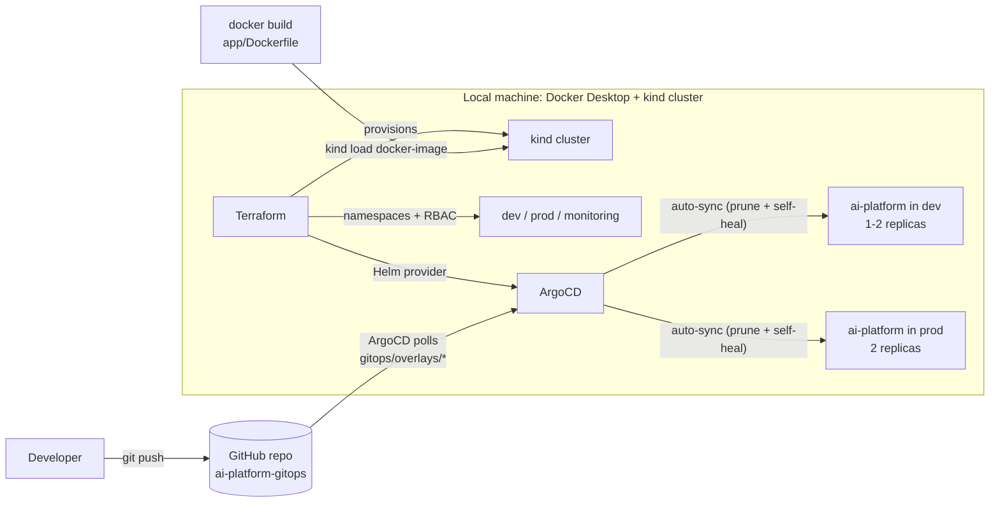
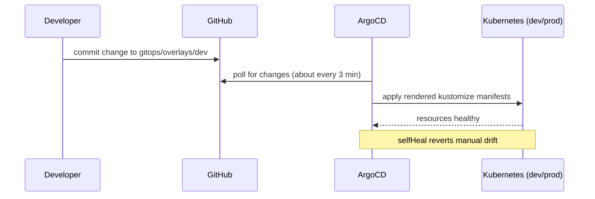

# ai-platform-gitops

A small FastAPI service delivered to a local Kubernetes cluster through a GitOps workflow: Terraform builds the environment, a Helm chart packages the app, kustomize overlays define dev and prod, and ArgoCD syncs both from this repository.

This is a **local personal project** running on a kind cluster on a laptop. It is not a production setup and uses no cloud services.

## Architecture



### The delivery loop



## What is in the repo

| Path | Purpose |
|---|---|
| `app/` | FastAPI service (`/healthz`, `/predict`, `/metrics`) and a multi-stage, non-root Dockerfile |
| `terraform/` | kind cluster, `dev`/`prod`/`monitoring` namespaces, namespace-scoped read-only RBAC, ArgoCD install (Helm provider, chart pinned to 10.10.3) |
| `chart/` | Helm chart for the service: Deployment, Service, ConfigMap, probes, resource requests and limits |
| `gitops/base/` | Plain kustomize base for the service |
| `gitops/overlays/dev`, `gitops/overlays/prod` | Per-environment overlays: namespace, `APP_ENV`, replicas, resources |
| `gitops/apps/` | ArgoCD `Application` manifests, one per environment, with automated sync |

## The application

- `GET /healthz` returns `{"status":"ok"}`.
- `POST /predict` takes `{"text": "..."}` and returns a label and confidence. The model is a keyword-based stub standing in for a real one.
- `GET /metrics` exposes Prometheus metrics (request counter and latency histogram).
- The container runs as uid 10001 with all capabilities dropped.

## How the pieces fit

- **Terraform** builds the base environment. `terraform apply` creates the cluster, namespaces, RBAC and the ArgoCD release.
- **Helm chart** was installed by hand into `dev` to verify the packaging (lint, render, install, probes, endpoints).
- **ArgoCD deploys from `gitops/`, not from `chart/`.** The kustomize base mirrors what the chart renders. I chose a plain base to avoid changing ArgoCD's configuration while it was restarting.
- **dev and prod differ only in overlays**: namespace, `APP_ENV`, replica count and resource limits.
- **The Application manifests are applied once with `kubectl apply`.** They are not managed by Terraform.
- **The image is loaded into the node with `kind load docker-image`.** There is no registry.

## Reproduce it

Prerequisites: Docker Desktop, kind, kubectl, helm, terraform.

```bash
# 1. Build the image
docker build -t ai-platform:0.1.0 app

# 2. Create the cluster, namespaces, RBAC and ArgoCD
cd terraform
terraform init
terraform plan -parallelism=1 -out=tfplan
terraform apply tfplan
cd ..

# 3. Load the image into the node
kind load docker-image ai-platform:0.1.0 --name ai-platform

# 4. Register the two ArgoCD Applications (one-time bootstrap)
kubectl --context kind-ai-platform apply -f gitops/apps/ai-platform-dev.yaml -f gitops/apps/ai-platform-prod.yaml

# 5. Watch them sync
kubectl --context kind-ai-platform get applications -n argocd
```

Always pass `--context kind-ai-platform` to kubectl and `--kube-context kind-ai-platform` to helm. Docker Desktop's built-in cluster can be the default context.

## Try the GitOps loop

1. Change `count` under `replicas` in `gitops/overlays/dev/kustomization.yaml`.
2. Commit and push.
3. Within a few minutes ArgoCD applies it with no manual step:
   `kubectl --context kind-ai-platform get deploy ai-platform -n dev`

## Known limitations

- **Resource-constrained host.** Developed on a Windows laptop with about 6 GB RAM, with the WSL2 VM capped at 4 GB. The ArgoCD server and repo-server pods have restarted repeatedly (liveness probe kills), and some control-plane components have restarted too. Raising probe timeouts did not help. The leading hypothesis is memory pressure on the host, but the root cause is not proven.
- **No registry.** The image is loaded straight into the kind node.
- **ArgoCD Applications are bootstrapped manually**, not through Terraform.
- **The stub model is not a real model.**

## Planned

- Prometheus and Grafana: scrape `/metrics`, a dashboard for request rate, latency and error rate, and one alert rule. A lighter install than kube-prometheus-stack will be used to fit the machine.
- Sealed Secrets for committing secrets safely to Git.
- Runbook: deploy, roll back through ArgoCD, and what to do when the node stalls.

## Not covered

OpenShift. This is plain Kubernetes.
