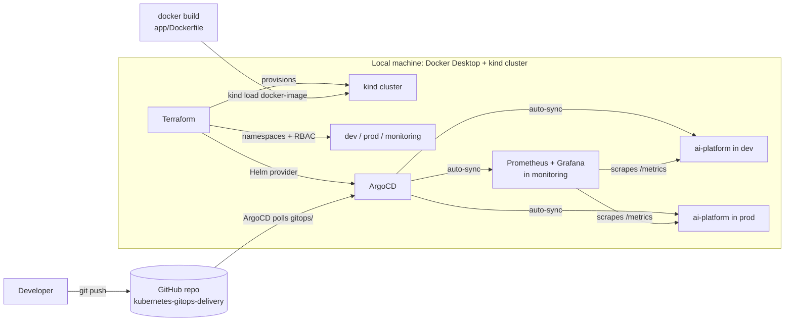
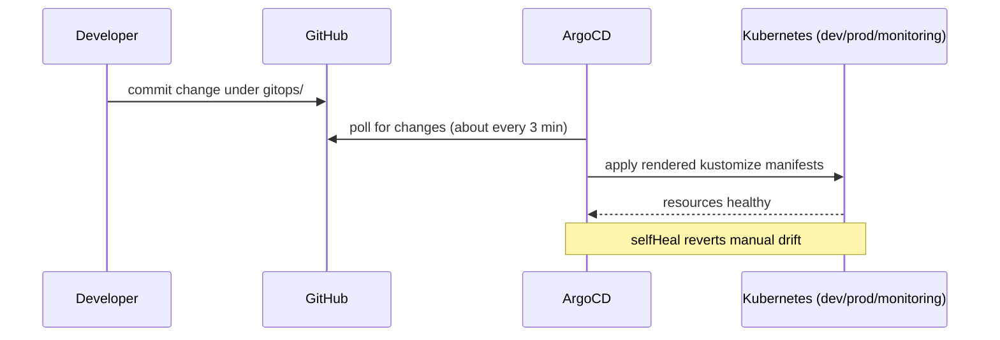
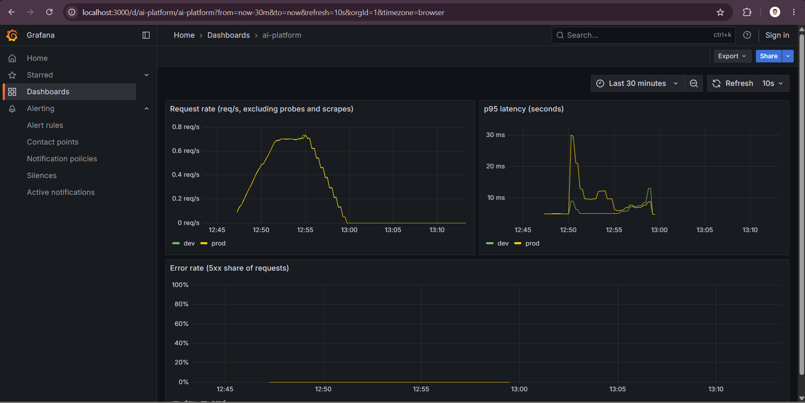
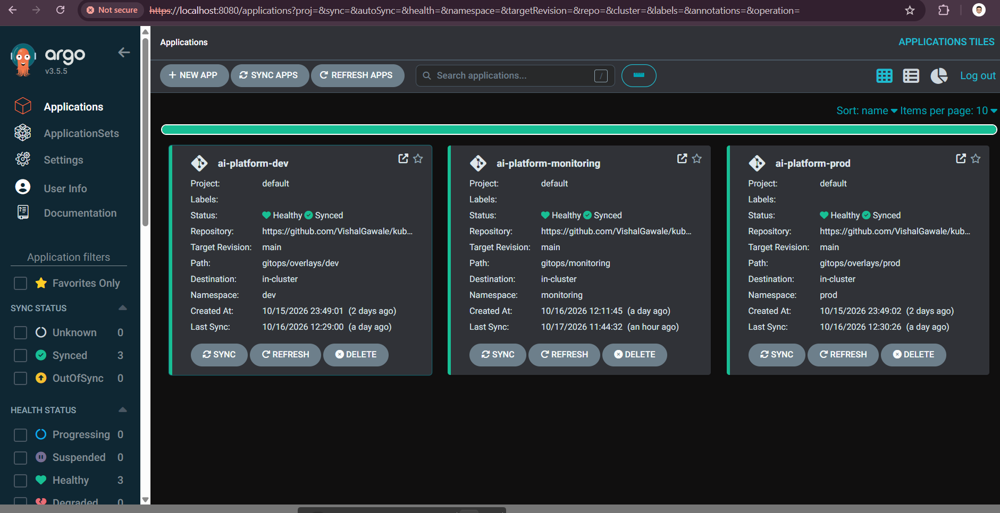

# Kubernetes GitOps Delivery

A GitOps delivery path for a small FastAPI service: Terraform provisions the cluster, namespaces and namespace-scoped RBAC and installs ArgoCD; a Helm chart packages the app (verified by a manual install); kustomize overlays define dev and prod; ArgoCD syncs dev, prod and a monitoring stack from Git; Prometheus and Grafana track request rate, p95 latency and error rate. Runs on a local kind cluster.

This is a **local personal project** running on a kind cluster on a laptop. It is not a production setup and uses no cloud services.

## Architecture



### The delivery loop



## What is in the repo

| Path | Purpose |
|---|---|
| `app/` | FastAPI service (`/healthz`, `/predict`, `/metrics`) and a multi-stage, non-root Dockerfile |
| `terraform/` | kind cluster, `dev`/`prod`/`monitoring` namespaces, namespace-scoped read-only RBAC, ArgoCD install (Helm provider, chart pinned to 10.10.3) |
| `chart/` | Helm chart for the service: Deployment, Service, ConfigMap, probes, resource requests and limits |
| `gitops/base/` | Plain kustomize base for the service, plus a headless Service for per-pod metrics scraping |
| `gitops/overlays/dev`, `gitops/overlays/prod` | Per-environment overlays: namespace, `APP_ENV`, resources |
| `gitops/monitoring/` | Prometheus and Grafana manifests, scrape config, alert rule with a promtool unit test, provisioned dashboard |
| `gitops/apps/` | Three ArgoCD `Application` manifests (dev, prod, monitoring) with automated sync |
| `docs/` | Screenshots used in this README |

## The application

- `GET /healthz` returns `{"status":"ok"}`.
- `POST /predict` takes `{"text": "..."}` and returns a label and confidence. The model is a keyword-based stub, not a trained model.
- `GET /metrics` exposes `http_requests_total{method,path,status}` and `http_request_duration_seconds`.
- The container runs as uid 10001 with all capabilities dropped.

## Monitoring



Request rate, p95 latency and error rate for dev and prod, with synthetic traffic on the local kind cluster.

- Prometheus and Grafana are plain manifests under `gitops/monitoring/`, deployed by their own ArgoCD Application.
- Each app pod is scraped separately through a headless Service (`ai-platform-metrics`) and DNS discovery. Scraping the load-balanced Service mixed counters from different pods into one series.
- The alert rule `HighErrorRate` fires when 5xx responses exceed 5 percent of requests for 2 minutes. It is validated with a `promtool` unit test (`gitops/monitoring/tests/alerts_test.yml`). It has not fired against live traffic, and there is no Alertmanager, so nothing sends notifications.
- Prometheus keeps 6 hours of data in an `emptyDir`, so history is lost when the pod restarts.
- Grafana allows anonymous read-only access and is reached only through `kubectl port-forward`.



All three Applications synced from Git.

## How the pieces fit

- **Terraform** builds the base environment. `terraform apply` creates the cluster, namespaces, RBAC and the ArgoCD release.
- **The Helm chart** was installed by hand into `dev` to verify the packaging (lint, render, install, probes, endpoints).
- **ArgoCD deploys from `gitops/`, not from `chart/`.** The kustomize base mirrors what the chart renders.
- **dev and prod differ only in overlays**: namespace, `APP_ENV` and resource limits.
- **The Application manifests are applied once with `kubectl apply`.** They are not managed by Terraform.
- **The image is loaded into the node with `kind load docker-image`.** There is no registry and no CI.

## Reproduce it

Prerequisites: Docker Desktop, kind, kubectl, helm, terraform.

```bash
# 1. Build the image
docker build -t ai-platform:0.1.0 app

# 2. Create the cluster, namespaces, RBAC and ArgoCD
cd terraform
terraform init
terraform plan -parallelism=1 -out=tfplan
terraform apply tfplan
cd ..

# 3. Load the image into the node
kind load docker-image ai-platform:0.1.0 --name ai-platform

# 4. Register the three ArgoCD Applications (one-time bootstrap)
kubectl --context kind-ai-platform apply -f gitops/apps/

# 5. Watch them sync
kubectl --context kind-ai-platform get applications -n argocd
```

Always pass `--context kind-ai-platform` to kubectl and `--kube-context kind-ai-platform` to helm. Docker Desktop's built-in cluster can be the default context. These steps have not been tested from a clean machine.

## Try the GitOps loop

1. Change `count` under `replicas` in `gitops/overlays/dev/kustomization.yaml`.
2. Commit and push.
3. Within a few minutes ArgoCD applies it with no manual step:
   `kubectl --context kind-ai-platform get deploy ai-platform -n dev`

## Known limitations

- **Resource-constrained host.** Developed on a Windows laptop with 8 GB RAM, of which Windows reports 5.9 GB usable, and the WSL2 VM capped at 4 GB. ArgoCD, the app pods and the control plane restarted repeatedly. Raising probe timeouts did not help, and the evidence points to node-wide stalls. Host memory pressure is the leading hypothesis, but the root cause is not proven.
- **Names.** Kubernetes resources, the image and the kind cluster keep the original name `ai-platform`. The service is a keyword stub, not an AI model.
- **No CI.** Images are built and loaded by hand.
- **No registry.** The image is loaded straight into the kind node.
- **Bootstrap.** The ArgoCD Applications are applied manually, not through Terraform.
- **The alert rule** is unit-tested but has not fired live.

## Planned

- Sealed Secrets for committing secrets safely to Git.
- A runbook: deploy, roll back through ArgoCD, and what to do when the node stalls.
